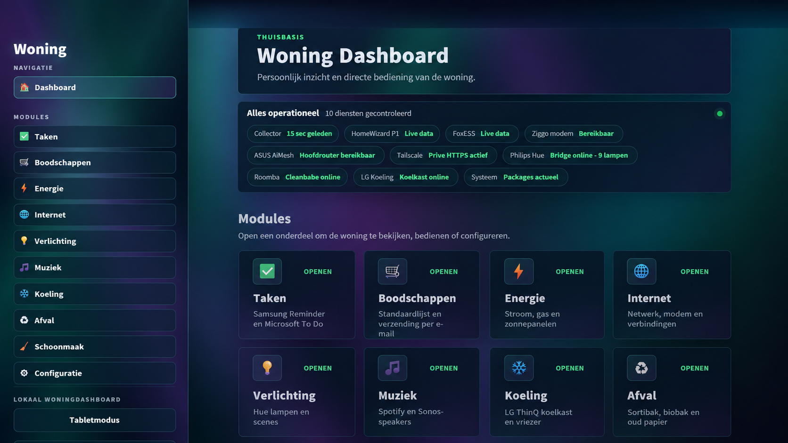
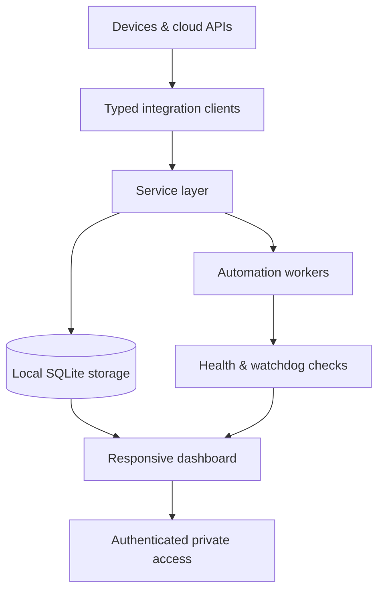
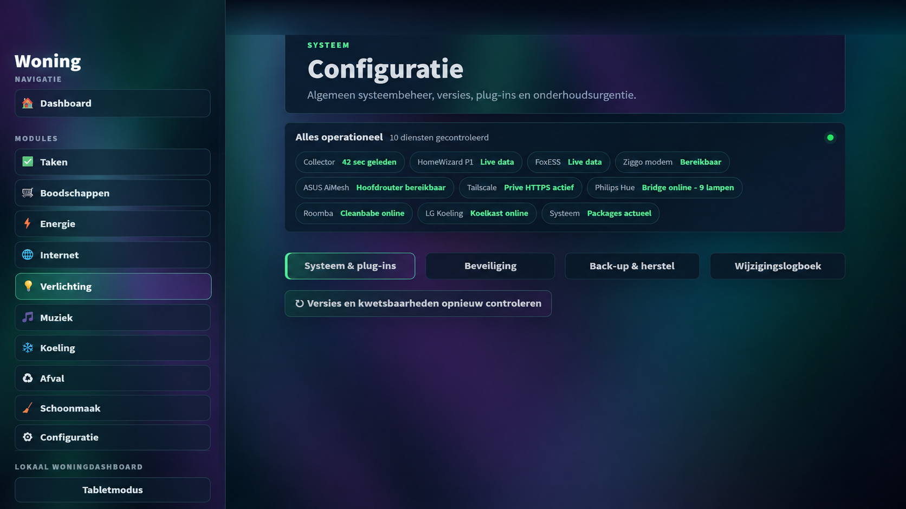
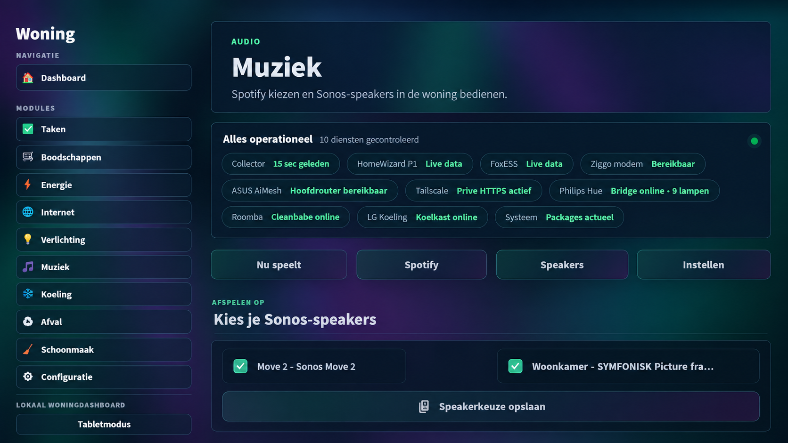
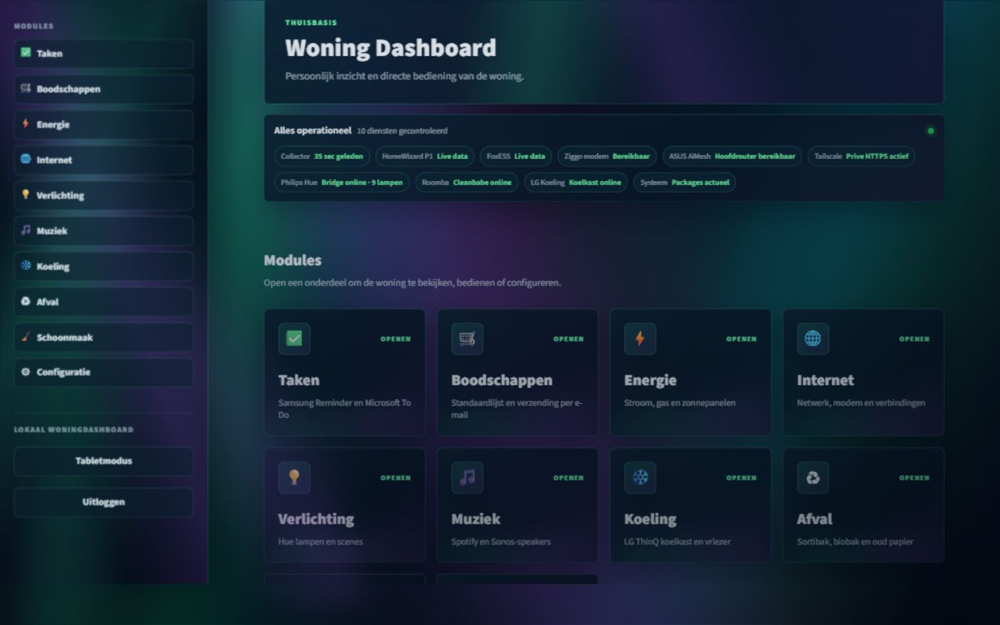
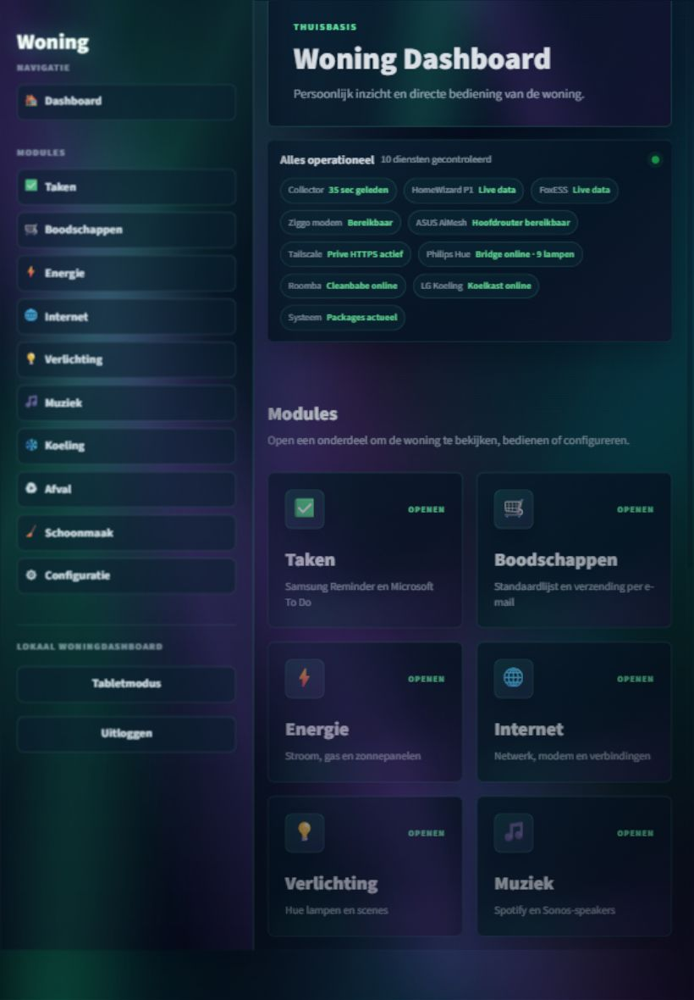
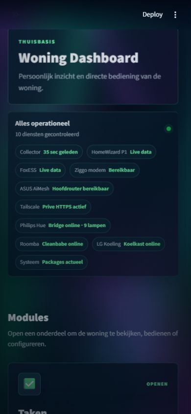

# Smart Home Operations Dashboard

## Project overview

This repository presents a privately hosted smart-home operations dashboard that brings energy, lighting, network, climate, audio, tasks and household services together in one responsive interface.

The application was designed and developed by **Ellen Rensenbrink / SiteGuardly** as a modular Python system with local-first data handling and controlled integrations.

## The challenge

Connected-home products often have separate apps, authentication methods and data formats. The project turns those independent systems into one consistent experience while keeping credentials and device access private.

The dashboard combines information and controls for:

- HomeWizard P1 energy data;
- FoxESS solar production;
- Philips Hue lighting and scenes;
- Sonos and Spotify playback;
- router, modem and internet quality monitoring;
- household tasks and shopping lists;
- cooling, waste and cleaning workflows;
- system health, backups and maintenance.

## Architecture

Integrations are isolated behind clients and services instead of being embedded directly in page code. This makes individual devices replaceable, improves testability and keeps the interface responsive when an external service is temporarily unavailable.

## Selected capabilities

- Live energy flow, solar production and consumption analysis.
- Historical period comparison, tariffs and cost calculations.
- Lighting controls, scenes and scheduled overrides.
- Speaker selection and multi-room audio controls.
- Internet quality history and local network status.
- Background collectors with heartbeat monitoring.
- Watchdog recovery for individual services.
- Validated backups and controlled restore procedures.
- Configuration change logging with sensitive-value masking.
- Desktop, tablet and mobile layouts.
- Automated unit, integration, security and visual regression tests.

## Interface examples

### System health and maintenance

The configuration area brings service health, security checks, backup controls and the change log into one operator view.

### Audio integration

The music module provides a consistent interface for Spotify and Sonos devices without exposing device credentials to the browser.

### Responsive layouts

The same application is optimised for desktop, tablet and phone use.

| Desktop | Tablet | Mobile |
| --- | --- | --- |
|  |  |  |

## Security and resilience

- The application is not directly exposed to the public internet.
- API keys and device credentials remain outside version control.
- Sensitive credentials are stored through the operating system credential store.
- Local access requires authentication.
- Private remote access uses an authenticated encrypted network path.
- Individual collectors can recover without restarting the entire platform.
- Backups exclude credentials and are validated before restore.

## Engineering focus

This project demonstrates experience with:

- Python and Streamlit application development;
- heterogeneous API and IoT integrations;
- resilient service and repository patterns;
- responsive interface design;
- background processes and watchdogs;
- local security and credential management;
- data modelling, SQLite and migrations;
- automated quality and visual regression testing.

## Privacy and availability

This is a **portfolio case study**. Production source code, device identifiers, network information, credentials and household data are intentionally kept private.

